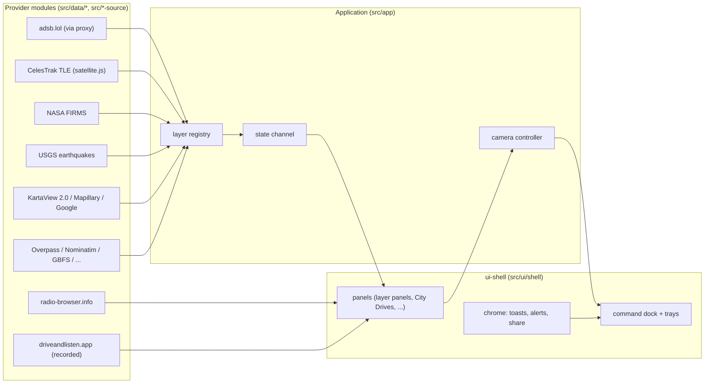

# Architecture.md — Technical map

Documents the ACTUAL repo as of `origin/main` 2026-10-19, not an imagined
one. Entry points, real paths, real flows. Proposed future work lives in
`docs/Tasks.md`, clearly separated from what exists.

## Repository overview

- **Stack:** Vite + Cesium (3D globe) + deck.gl overlays, ES modules.
  132 module groups enforced by `scripts/package-boundaries.json`
  (`npm run check:boundaries`).
- **Entry points:** `src/app/application.js` (application bootstrap),
  `src/ui/shell` (ui-shell group — command dock, trays, panels).
- **Demo:** https://niteshlhsnda-droid.github.io/gods-eye-view/ (GitHub
  Pages project site — the vite config sets no base, so the base MUST
  come from the build command).

## System map



**Provider → layer → panel flow:**
1. **Source** — provider module fetches (HTTP) or computes (SGP4).
2. **Ingestion** — normalize to the layer's record shape; empty-but-valid
   responses (e.g. adsb.lol `{"ac":[],"total":0}`) are valid snapshots,
   never errors.
3. **Registry** — 30 catalog layers + 1 local-only (own ADS-B receiver).
4. **State/cache** — `src/app/stateChannel.js`; panels subscribe.
5. **Visualization** — Cesium entities / deck.gl layers.
6. **User interaction** — panels, trays, cockpit, voice, search.

**Refresh:** each provider owns its cadence; the cadence must be visible
next to any LIVE label (see `docs/Design.md` state catalog). Verified
examples: street-level fetch timeouts 12s/20s, retries=2; KartaView
concurrency 2 with 429 retry. Do not invent intervals — read the
provider module.

## Lifecycle and cleanup

Panels that open/close repeatedly (City Drives, layer panels) must
release resources: `destroy()` removes rendered DOM, stops audio,
clears timers, unsubscribes listeners. Audio (e.g. City Drives radio)
stops on panel close or city change. No orphaned WebGL resources,
timers, or subscriptions on teardown.

## Module boundaries (machine-enforced)

- `scripts/package-boundaries.json` is the contract. Register every new
  module in **every group** whose build graph reaches it (surgical
  inserts; never rewrite wholesale).
- `ui-shell` must NEVER import `../locations.js` — use the shell's own
  `applyCameraState({lat, lon, alt, heading, pitch})`.
- `src/tooling/*.js` may not import `node:fs`/`node:path`
  (browserModuleBoundary); move such modules to `scripts/*.mjs`.
- Idea-cycle branches are additive-only vs their base; disjoint file
  sets per lane.

## External dependencies

| Dependency | Use | Key handling |
|---|---|---|
| Cesium Ion (asset 2275207, Google Photorealistic 3D Tiles) | 3D tiles | token `gods-eye-view-demo` via `CESIUM_ION_TOKEN` build env only; domain-restricted; never in code |
| adsb.lol | live flights | via proxy; empty `{"ac":[]}` = valid |
| radio-browser.info | City Drives live radio | runtime resolution, community directory |
| driveandlisten.app | City Drives drive-throughs | RECORDED iframe embed, credited |
| KartaView `api.kartaview.org/2.0/` | street level | keyless; v1 is dead |
| Mapillary | street level (default) | free token, not in public bundle |
| Google Maps/Street View | street level (opt-in) | key only via `window.__GOOGLE_MAPS_API_KEY__`; chip OFF |

## Build / test / deploy (exact commands)

```bash
# build (ALWAYS with the base flag)
CESIUM_ION_TOKEN=$TOKEN vite build --base=/gods-eye-view/
# boundaries + format
npm run check:boundaries
npm run format:check
# tests: targeted per lane; full suite solo, never piped, never concurrent
node --test <path/to/test.mjs>
```

Push to `origin/main`: `push_main_fastforward.py` (Git Data API
fast-forward). Before each push: re-point BASE (remote main SHA),
HEAD (new tip via `git rev-parse`), REPO_DIR (worktree with commits),
and `git fetch origin main` first — API pushes don't move the local
`origin/main` ref. Verify live via build-metadata + asset checks
(`local-pages-deploy-verify` skill).

## Fork and upstream

- Fork of the original God's Eye View; upstream compare clone for
  research. Upstream demo `maptheworld.ai` is dead — research via repo
  + docs, never copy without attribution.
- Port branch `port/upstream-gaps` fully merged to main 2026-10-17
  (ancestry-verified). NYC DOT CCTV is agreement-gated and NOT ported.
